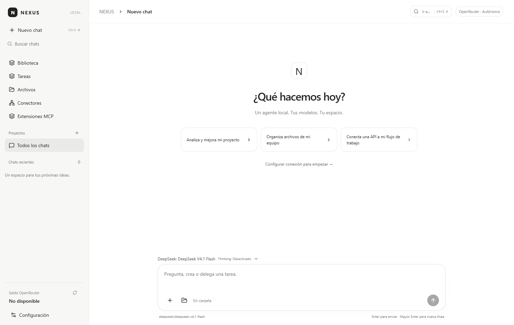

# NEXUS — Standalone Native Agentic Coding, Private Browser & Personal Operator Workstation

**NEXUS (`v1.1.0`)** is an open, local-first **Standalone Native Windows Agentic Workstation** built with **.NET 10 + Microsoft WebView2 (Zero Electron)**, a decoupled **Node 24 ESM Core Engine**, and a modular **React 19 + Vite 8 Studio UI**.

Designed for maximum personal autonomy and hackability, NEXUS imposes **zero client-side content filters or artificial generation caps**—delegating content policy solely to the model provider you choose while granting full, auditable power over your local Windows environment, codebase, Win32 ConPTY terminal, Git repositories, integrated browser, REST APIs, dynamic JS plugins, and Model Context Protocol (MCP) servers.



---

## Key Capabilities (`v1.1.0`)

### 1. Native Windows Architecture (Zero Electron)
- **Standalone Native Host (`desktop/native-host/`)**: C# / .NET 10 WinForms + official Windows `Microsoft.Web.WebView2` runtime (no Electron, no bundled Chromium). Includes native Win11 dark titlebar (`DWMWA`), System Tray, global summon hotkey (`Ctrl+Shift+Space`), single-instance lock, crash watchdogs (`host.log` / `core.log`), WebView2 auto-recovery, and Core daemon auto-restart.
- **Native Win32 ConPTY Terminal & Desktop Automation**: Pure Win32 `CreatePseudoConsole` (`ConPtyHost.cs`, zero `node-pty`) for real interactive PowerShell/CMD/TUI sessions with Tab completion, arrow keys, Ctrl+C, and resize, plus fast native C# Win32 screenshot & input automation (`NativeDesktop.cs`).
- **Decoupled Core Engine (`desktop/core/server.mjs`)**: Zero-dependency Node 24 HTTP + SSE daemon with loopback-only CORS, constant-time token auth, live-reloading `nexus.config.json`, Windows DPAPI secret vault (stdin-piped, rotating backups), and standalone Web (`npm run start:web`) or Headless API (`npm run start:headless`) modes.

### 2. Multi-Provider Model Engine (10 Built-In + Unlimited Custom Profiles)
Switch globally or per chat across **10 built-in providers** plus **unlimited user-defined Custom Provider Profiles** (OpenAI or Anthropic wire format):
- **OpenRouter** (`owner/model`) — 300+ models, ephemeral prompt caching breakpoints for Claude/Gemini, routing priority (`Auto`/`Cheapest`/`Fastest`/`Lowest Latency`), upstream provider pinning, session cache affinity, and native server web search.
- **Arli.ai** (`arliai/<model>`) — High-context coding (`DeepSeek-V4.1-Flash-1017`) and derestricted models (`GLM-4.6-Derestricted-v5`).
- **OpenAI Direct** (`openai/<model>`) — `gpt-5`, `gpt-5-mini`, `gpt-4.1`, `o3`, `o4-mini` with `reasoning_effort`, `prompt_cache_key`, and streaming usage telemetry.
- **Anthropic Direct** (`anthropic/<model>`) — Native `/v1/messages` + SSE streaming, prompt caching breakpoints, and extended thinking (`thinking` budget).
- **GitHub Copilot** (`copilot/<model>`) — Automatic OAuth → short-lived Copilot session token exchange with **1-click import** from `gh auth token` or local Copilot config.
- **DeepSeek Direct** (`deepseek-direct/<model>`), **Google Gemini** (`gemini/<model>`), **xAI Grok** (`xai/<model>`), **Groq** (`groq/<model>`), and **Custom / Local** (`custom/<model>` for Ollama, LM Studio, vLLM, llama.cpp with no API key required).
- **Copilot-Style Model Picker Popover**: Filter by freedom/restriction tier, capabilities (`Frontier`, `Coding`, `Reasoning`, `Fast`, `Vision`, `200K+ Ctx`, `Budget/Free`), inline reasoning effort, context ceiling, and raw generation overrides (`temperature`, `topP`, `seed`, `extraBody`, `extraHeaders`).

### 3. 4-Tier Autonomy Levels, Granular Rules & Slash Commands
- **Interactive** — Confirm every modifying or external tool action.
- **Semi-Autopilot** — Auto-runs read-only tools and safe workspace edits; prompts with exact risk reason on destructive shell commands, deletions, outside-workspace writes, `git push`/`commit`, or external HTTP mutations, backed by editable **Allow/Deny Rules** (`tool:substring` or `/regex/i`) and 1-click **Always Allow**.
- **Autopilot** — Executes engineering tasks autonomously end-to-end.
- **Unrestricted** — Zero local path confinement and zero approval prompts across the host machine.
- **10 Built-in Slash Commands** (`/compact`, `/init`, `/review`, `/architect`, `/diagnostics`, `/explain`, `/fix`, `/test`, `/mcp-create`, `/self-improve`) plus custom user-defined slash commands in `nexus.config.json`.

### 4. 61 Built-In Agentic Tools & Smart Lazy Toolsets
- **Smart Lazy Toolsets (`load_toolset`)**: Optionally start with **18 core tools** and activate **10 on-demand groups** (`git`, `shell_processes`, `web_browser`, `sessions`, `capabilities_mcp`, `connectors`, `memory_history`, `desktop`, `automations_evolve`, `plugins`), reducing Step-1 input tokens by ~65%.
- **Surgical Code Editing & Navigation**: `read_file` (line-range slicing up to 10 MB), `batch_read_files`, `dir_tree`, `write_file`, `replace_text`, `multi_edit`, `apply_patch` (`SEARCH/REPLACE` and unified `@@` diffs), `delete_file` / `move_file` (with automatic backups & 1-click rollback), `run_diagnostics`, `glob_files`, `grep_search`, and `code_outline`.
- **Git, Worktrees, Stateful Shell & Processes**: `git_operation` (`status`, `diff`, `log`, `branch`, `checkout`, `checkout_new`, `discard`, `stash`, `pull`, `push`, `stage`, `unstage`, `commit`, `worktree_list`, `worktree_add`, `worktree_remove`), `shell_session`, `run_command`, `manage_process`, and `system_info`.
- **Web, HTTP, OpenAPI & Desktop Control**: `web_search` (built-in DuckDuckGo/Bing fallback, zero API keys), `web_fetch`, `http_request`, `browser_inspect`, OpenAPI 3.0/3.1 importer, idempotent REST connectors, and `desktop_screenshot` / `desktop_action`.

### 5. Integrated Account / InPrivate Browser & App-Scoped Tor/Proxy
- **Side-Panel & Full-View Browser (`BrowserSidePanel` / `PrivateBrowserView`)**: Embedded WebView2 browser alongside chat or in full view.
- **Account Mode vs. InPrivate Mode**: Keep logins/cookies isolated inside NEXUS in Account mode, or switch to ephemeral zero-trace InPrivate sessions with 1-click **Wipe**.
- **App-Scoped Privacy Networking**: NEXUS-managed portable Tor (`127.0.0.1:9055`, never touches Windows system proxy), SOCKS5/HTTP proxy support, system VPN detection, tracker domain blocking, anti-fingerprinting, **Send to AI**, and **Screenshot to Chat**.

### 6. Rooted Projects, Nested Sessions, Skills Gallery & Local Automations
- **Rooted Projects & Concurrent Nested Sessions**: Bind projects to root folders to auto-discover `NEXUS.md`, `CLAUDE.md`, `AGENTS.md`, `.cursorrules`, and `.nexus/.github/.claude/skills/*/SKILL.md`. Agents can orchestrate concurrent nested child sessions (`spawn_session`, `list_sessions`, `send_session_message`, `read_session`) with automatic parent handoff.
- **Skills & Plugins Gallery (`GalleryView`)**: 12 curated skills, 4 zero-dependency hot-loaded native JS plugins (`SQLite Explorer`, `Network Diagnostics`, `Dev Crypto & JWT`, `Archive Pack`), 9 1-click Cloud MCP plugins (with live connect & tool test), live GitHub `SKILL.md` search/import, and live self-evolution (`create_dynamic_tool`, `scaffold_mcp_server`, `self_improve`).
- **Local Automations & Multi-Model Arena**: Schedule recurring autonomous missions (interval, daily, weekly, 5-field cron, one-shot) via `AutomationsView` or `manage_automation`, and benchmark 2–4 models side-by-side in **Model Arena**.

### 7. Zero-Flicker Studio UI & 2-Stage Lossless Compaction
- **Studio Themes & Live Hackability**: Obsidian Dark, Studio Paper Light, and Midnight Slate themes, accent color picker, Live Custom CSS editor, block-memoized streaming Markdown with **Mermaid** (`securityLevel: 'strict'`) and **KaTeX**, inline unified diffs with 1-click **Revert**, `@`-file and `/`-slash autocomplete, 40-turn progressive DOM windowing, and raw `nexus.config.json` editor.
- **2-Stage Lossless Compaction**: Stage 1 `$0` Micro-Compaction prunes old oversized tool outputs into lossless artifact references before Stage 2 structured checkpoint compaction. Originals and pinned messages are always preserved; hidden reasoning is never resent across turns.

---

## Quick Start (Portable Bundle or From Source)

### Option A: Portable Windows Release
Download **`NEXUS-Portable-Windows.zip`** from the [**GitHub Releases**](https://github.com/Ezequiel24123z/Nexus/releases) page, extract it anywhere, and launch **`NEXUS.exe`**—includes WebView2 loader, bundled Node 24 runtime, core engine, and UI with no installer required.

### Option B: Run or Build from Source
Requirements: Windows 10/11, Git, **Node.js 24.12.0** (`.node-version`), and **.NET 10 SDK**.

```powershell
git clone https://github.com/Ezequiel24123z/Nexus.git
cd Nexus\desktop
npm ci
npm test
npm run build
npm start
```

Or double-click `desktop\Launch NEXUS.cmd`. You can also run without the native window:

```powershell
npm run start:web       # Launches local core daemon and opens UI in your default browser
npm run start:headless  # Runs local HTTP + SSE core API daemon on 127.0.0.1:4789
```

To build the self-contained portable release bundle (`desktop/release/NEXUS-Portable/` + `desktop/release/NEXUS-Portable-Windows.zip`):

```powershell
cd desktop
npm run dist:portable
```

---

## Documentation

| Document | Contents |
| --- | --- |
| [Changelog](CHANGELOG.md) | Release history across `v1.1.0`, `v0.4.0`, and `v0.3.0` |
| [Architecture](docs/ARQUITECTURA.md) | Module map, runtime data flow, security boundaries, and durability invariants |
| [Status & Roadmap](docs/ESTADO-Y-ROADMAP.md) | Implemented `v1.1.0` capabilities and audit hardening status |
| [Validation](docs/VALIDACION.md) | Automated Node test suite, Vite build, native host build, and visual/E2E checks |
| [Desktop Manual](desktop/README.md) | Launch modes, providers, tools, browser, and live configuration guide |
| [VM & Copilot Setup](docs/VM-Y-COPILOT.md) | Clean development setup on Windows with Node 24, .NET 10, and Copilot |
| [Agent Instructions](AGENTS.md) | Development and verification workflow for coding agents |

---

## Security & Local Privacy
- **Windows DPAPI Secret Vault (`core/vault.mjs`)**: API keys and connector secrets are encrypted with CurrentUser DPAPI (`vault.dpapi`) piped exclusively over `stdin` (never exposed in CLI process arguments), with automatic rotating backups (latest 5). Secrets never enter model prompts or renderer snapshots.
- **Hardened Local Transport & UI**: Local HTTP/SSE server enforces loopback-only CORS, constant-time bearer token auth, strict workspace containment on file endpoints, safe shell opening without `cmd.exe` injection, origin-verified WebView2 bridge, validated browser proxy URIs, and strict Mermaid SVG sanitization.
- **Durable Continuity**: Conversations, JSONL journals, external effect ledgers (`intended → dispatched → observed / uncertain`), and compaction checkpoints persist locally in atomic JSON or incremental WAL SQLite (`node:sqlite`).
