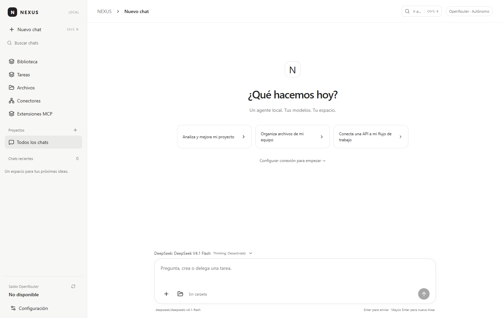

# NEXUS — Autonomous Agentic Coding & Personal Operator IDE

**NEXUS** is an open, local-first **Agentic Coding & Personal Operator Workspace** for Windows, built with Electron, React 19, and a durable Node.js ESM execution engine.

Designed for maximum personal autonomy, NEXUS imposes **zero client-side content filters or artificial guardrails**—delegating content policy solely to the model provider you choose while granting full, auditable power over your local environment, codebase, shell, Git repositories, desktop UI, REST APIs, and Model Context Protocol (MCP) servers.



---

## Key Capabilities

### 1. Multi-Provider Model Engine
Switch per-chat or globally across **6 provider backends**:
- **OpenRouter** (`owner/model`) — 300+ models, prompt caching affinity, provider routing (`price`, `throughput`, `latency`), and native server web search.
- **Arli.ai** (`arliai/<model>`) — High-context coding (`DeepSeek-V4.1-Flash-1017`) and uncensored/derestricted models (`GLM-4.6-Derestricted-v5`, `QwQ`).
- **OpenAI Direct** (`openai/<model>`) — Direct access to `gpt-5`, `gpt-5-mini`, `gpt-4.1`, `o3`, and `o4-mini` with native `reasoning_effort` and streaming token usage.
- **GitHub Copilot** (`copilot/<model>`) — Use your GitHub Copilot subscription (`claude-sonnet-4.5`, `gpt-5`, `gemini-2.5-pro`, `claude-opus-4.5`) with **1-click token import** from GitHub CLI (`gh auth token`) or local Copilot configuration.
- **Anthropic Direct** (`anthropic/<model>`) — Direct Claude 4.5 (`claude-sonnet-4-5`, `claude-opus-4-5`, `claude-haiku-4-5`).
- **Custom / Local OpenAI-Compatible** (`custom/<model>`) — Connect to **Ollama**, **LM Studio**, **vLLM**, or **llama.cpp** (`http://localhost:11434/v1`) with no API key required and zero external restrictions.

### 2. Four Operating Modes & Slash Commands
- **Agent Mode** (`agent`) — Full read/write coding, shell execution, Git operations, background processes, MCP builder, and sub-agent delegation.
- **Architect Mode** (`architect`) — Read-only codebase exploration + structured plan generation (`todo_write`) and architecture design.
- **Explore Mode** (`explore`) — Fast, read-only codebase research (`glob_files`, `grep_search`, `code_outline`, `read_file`).
- **Unrestricted Mode** (`unrestricted`) — Zero local path confinement or per-action approval prompts; full operator control over the host machine.
- **Built-in Slash Commands**: `/init` (auto-generate `NEXUS.md`), `/review` (structured diff & security review), `/architect` (step-by-step plan), `/diagnostics` (automated codebase syntax & diagnostic audit), `/mcp-create` (autonomous MCP server synthesis), and `/self-improve` (telemetry introspection & skill synthesis).

### 3. Industrial-Grade Agentic Coding Tool Suite (34 Built-In Tools)
- **Surgical Code Editing, Diagnostics & Navigation**: `read_file` (with 1-based `startLine`/`endLine` range slicing for files up to 10 MB), `write_file`, `replace_text`, `multi_edit` (atomic multi-hunk replacements with automatic backups), `apply_patch` (`SEARCH/REPLACE` blocks and unified `@@` diff hunks), `run_diagnostics` (automated syntax & structural verification across JS/MJS/CJS/JSON), `glob_files`, `grep_search` (regex + context lines), and `code_outline` (AST/symbol structural map).
- **Stateful Shell & Background Process Manager**:
  - `shell_session`: Persistent shell session per task that preserves working directory (`cd`/`Set-Location`) and environment variables (`$env:...`) across tool calls.
  - `manage_process` (`start`, `status`, `output`, `stop`, `list`) for asynchronous watchers, servers, and builds.
- **Git & Worktree Operations**: `git_operation` (`status`, `diff`, `log`, `branch`, `stage`, `unstage`, `commit`, `worktree_list`, `worktree_add`, `worktree_remove`).
- **Unrestricted HTTP, Web & Headless Browser Inspection**:
  - `http_request`: Full-featured HTTP/HTTPS client (`GET`, `POST`, `PUT`, `PATCH`, `DELETE`, `HEAD`, `OPTIONS`) with custom headers, payloads, status codes, and latency metrics for API testing and security auditing.
  - `browser_inspect`: Structured web page & DOM inspector (extracts page title, headings, interactive links, form inputs, and visible text, with optional offscreen JS rendering).
  - `web_fetch`, OpenAPI 3.0/3.1 importer, and REST connectors with `Idempotency-Key` reconciliation.
- **Autonomous MCP Server Creation & Self-Improvement**:
  - `scaffold_mcp_server`: The agent can write, register, and hot-connect new local Node.js stdio MCP servers on the fly without restarting.
  - `self_improve`: Introspects task telemetry and tool errors to synthesize reusable Skills and Functions into the local Capability Library.
- **Sub-Agents, Memory & Desktop Control**:
  - `delegate_subagent`: Spawns an isolated sub-agent loop with its own clean context window and returns a compact synthesis.
  - `todo_write` / `todo_read`: Live multi-step task checklist rendered in real time in the chat header.
  - `memory_store`: Persistent global and project-scoped memories across sessions, plus automatic discovery of `NEXUS.md`, `CLAUDE.md`, `AGENTS.md`, and `.cursorrules`.
  - Native Windows desktop control (`desktop_screenshot`, `desktop_action`).

### 4. Modern Studio UI/UX & Multi-Model Arena (Light & Dark Themes)
- **Light (`Studio Paper`)** and **Dark (`Obsidian Carbon`)** themes with comfortable/compact density and reduced-motion accessibility.
- **Multi-Model Arena**: Dispatch the same coding prompt simultaneously across 2–4 models (e.g., Claude Sonnet, GPT-5, DeepSeek, or local Ollama) to compare code quality, speed, and reasoning side-by-side.
- **Files & Git Studio**: Interactive file browser, live Git working-tree inspector, syntax-highlighted unified diff viewer, 1-click stage/unstage/commit, **Diagnostics** verifier, **Git Worktrees** manager, integrated PowerShell Quick Terminal, and Background Process Monitor.
- **Context, Cache & Spend Inspector**: Inspect token budgets per context section, cache hit rates, provider routes, and pre-compaction checkpoints with zero API calls.

---

## Quick Start (Single-Click Portable `.exe` or From Source)

### Option A: Single-Click Portable Executable (Windows)
Download **`NEXUS-Portable.exe`** from the [**GitHub Releases**](https://github.com/Ezequiel24123z/Nexus/releases) page and double-click it—no installation required.

### Option B: Run or Build from Source
Requirements: Windows, Git, and **Node.js 24.12.0** (`.node-version`).

```powershell
git clone https://github.com/Ezequiel24123z/Nexus.git
cd Nexus/desktop
npm ci
npm test
npm run build
npm start
```

To build the standalone single-click portable `.exe` yourself:

```powershell
cd desktop
npm run dist:portable
```

This generates `desktop/release/NEXUS-Portable.exe`.

---

## Documentation

| Document | Contents |
| --- | --- |
| [Architecture](docs/ARQUITECTURA.md) | Module map, runtime data flow, and durability invariants |
| [Status & Roadmap](docs/ESTADO-Y-ROADMAP.md) | Implemented capabilities and upcoming milestones |
| [Validation](docs/VALIDACION.md) | Automated unit tests, Electron UI smoke suite, and packaging checks |
| [Desktop Manual](desktop/README.md) | Detailed guide to providers, tools, storage, and recovery |
| [Agent Instructions](AGENTS.md) | Development and verification workflow for coding agents |

---

## Security & Local Privacy
- **Encrypted Local Vault**: API keys and tokens are encrypted on disk using Windows DPAPI (`Electron safeStorage`) with automatic rotating backups. Secrets never enter model prompts or renderer snapshots.
- **Durable Continuity**: Conversations, JSONL journals, effect ledgers (`intended → dispatched → observed / uncertain`), and compaction checkpoints are stored locally in JSON or incremental SQLite (`node:sqlite`).
